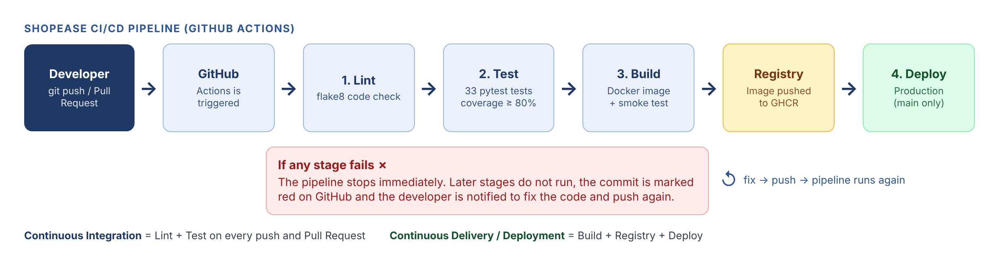
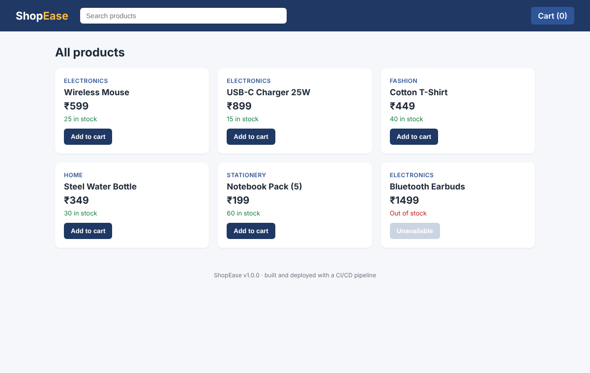
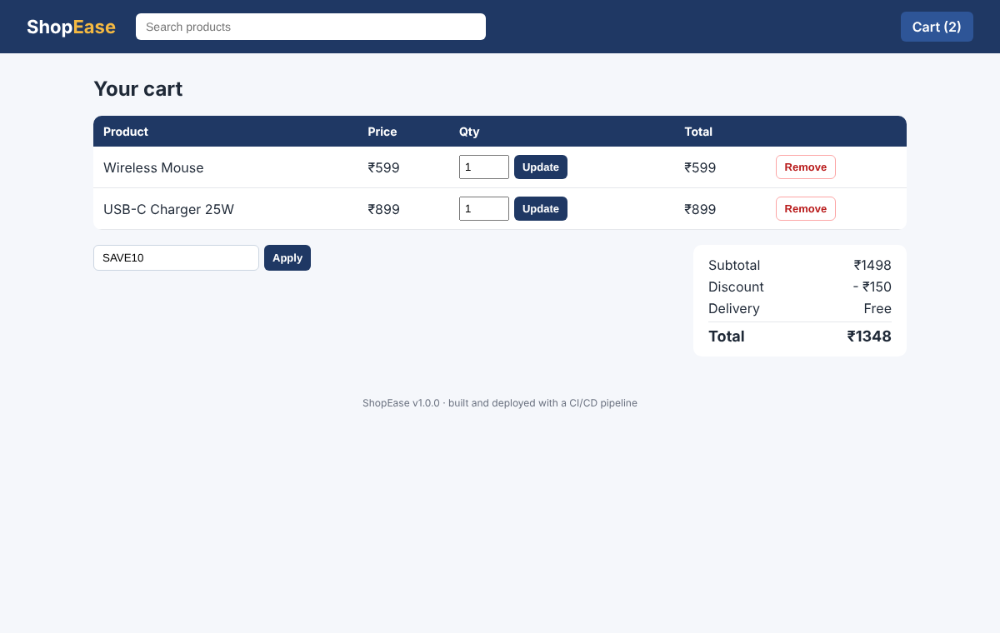

# EcoFinds – Online Shopping App with a DevOps CI/CD Pipeline


EcoFinds is a small online shopping web application built with **Python Flask**. The main goal of the project is **not** the shop itself. The goal is the **DevOps CI/CD pipeline** around it. Every time code is pushed to GitHub, the pipeline automatically **checks the code, runs the tests, builds a Docker image and deploys it**, with no manual testing or copying of files.

> Unit 5 – Case Study 3: *DevOps Practices and CI/CD Pipelines* · Software Engineering
> Siddharth P · NB25CSE347 · CSE E

---

## 1. Problem statement

A software company runs an online shopping application. Developers update it often to add features and fix bugs, but **testing and deployment are done by hand**. This causes:

- delays, because every release waits for someone to test and upload it manually
- bugs reaching customers, because manual testing misses cases
- "works on my machine" errors, because each server is set up differently

## 2. Objectives

1. Build a working shopping application (product list, search, cart, coupon, delivery charge).
2. Write automated **unit and integration tests** for it.
3. Create a **GitHub Actions** pipeline that lints, tests, builds and deploys automatically.
4. Package the app in **Docker** so it runs the same way everywhere.
5. Make the pipeline **block faulty code** before it reaches users.

## 3. Technologies used

| Area | Tool |
|---|---|
| Language / framework | Python 3, Flask 3.1, Jinja2 templates |
| Production server | Gunicorn |
| Testing | pytest, pytest-cov (coverage) |
| Code quality | flake8 |
| Containerisation | Docker (`python:3.12-slim`) |
| CI/CD | GitHub Actions |
| Image registry | GitHub Container Registry (GHCR) |
| Version control | Git and GitHub |

## 4. Project structure

```
EcoFinds-cicd/
├── .github/workflows/ci-cd.yml   # the CI/CD pipeline (4 stages)
├── app/
│   ├── __init__.py               # app factory + version
│   ├── routes.py                 # web pages + REST API + /health
│   ├── store.py                  # business logic (catalogue, cart, pricing)
│   ├── templates/                # base.html, index.html, cart.html
│   └── static/style.css
├── tests/
│   ├── test_store.py             # 19 unit tests
│   └── test_api.py               # 14 integration tests
├── scripts/run_pipeline.sh       # run the same stages locally
├── docs/                         # diagrams and screenshots
├── Dockerfile
├── requirements.txt / requirements-dev.txt
├── setup.cfg                     # flake8 + pytest settings
└── run.py                        # start the app locally
```

## 5. How the pipeline works



| Stage | Job | What happens | Runs on |
|---|---|---|---|
| 1 | **Lint** | `flake8 .` checks code style and common mistakes | every push and PR |
| 2 | **Test** | `pytest` runs 33 tests on Python 3.11 and 3.12; fails if coverage < 80% | every push and PR |
| 3 | **Build** | `docker build`, then start the container and call `/health` (smoke test); push the image to GHCR | build on every push and PR; push to GHCR only on `main` |
| 4 | **Deploy** | Calls the hosting platform's deploy hook | `main` only |

Each stage `needs` the one before it, so **if any stage fails, the later stages never run**.

## 6. Main features

**Shop (implemented)**
- Product list with category, price and stock; search by name
- Add to cart, change quantity, remove; out-of-stock and max-10-per-item rules
- Coupon `SAVE10` (10% off); ₹49 delivery, free at ₹999 and above
- REST API: `GET /api/products`, `GET /api/products/<id>`, `GET/POST /api/cart`, `DELETE /api/cart/<id>`
- `GET /health` endpoint used by the pipeline and the Docker health check

**DevOps (implemented)**
- 4-stage GitHub Actions workflow with job dependencies
- Test matrix for Python 3.11 and 3.12, with a coverage gate (80%) and an uploaded coverage report
- Docker image built with a cached dependency layer, running as a non-root user
- Automatic smoke test of the built container
- Local pipeline script that runs the same stages

## 7. Results (verified locally)

| Check | Result |
|---|---|
| flake8 lint | 0 issues |
| Tests | **33 passed**, 0 failed (19 unit + 14 integration) |
| Code coverage | **97%** (minimum required: 80%) |
| Docker build | Success, image size 188 MB |
| Container smoke test | `/health` returned `{"status":"ok","version":"1.0.0"}` |
| Bug-catching test | A deliberate bug in the delivery rule made **5 tests fail**, so the pipeline would stop |

> These results come from running the stages locally (Python 3.13, Docker). The GitHub Actions run itself appears under the **Actions** tab once the repository is pushed.

| Home page | Cart with coupon |
|---|---|
|  |  |

## 8. Run it yourself

```bash
# 1. Install
python -m venv .venv && source .venv/bin/activate      # Windows: .venv\Scripts\activate
pip install -r requirements-dev.txt

# 2. Run the app  ->  http://127.0.0.1:5000
python run.py

# 3. Run the checks
flake8 .
pytest -v --cov=app

# 4. Run with Docker  ->  http://localhost:8000
docker build -t EcoFinds .
docker run -p 8000:8000 EcoFinds

# 5. Run the whole pipeline locally
bash scripts/run_pipeline.sh
```

### Enabling automatic deployment
The deploy job is ready but needs a hosting target. Create a web service on a platform that offers a deploy hook (for example Render), then add its URL as a repository secret named `DEPLOY_HOOK_URL` (**Settings → Secrets and variables → Actions**). Until that secret exists, the deploy job prints a message and skips safely.

## 9. Implemented vs proposed

| Implemented and tested | Proposed (future work) |
|---|---|
| Shop app, REST API, 33 tests, lint, Docker image, smoke test, workflow file, GHCR push step, deploy step (needs secret) | Live hosting with a public URL, a real database (PostgreSQL), user login and payments, staging environment, Slack/email alerts, security scanning (e.g. CodeQL, Trivy) |

## 10. Future improvements
- Add a PostgreSQL database instead of in-memory products
- Add a **staging** environment with manual approval before production
- Add security scans (CodeQL for code, Trivy for the Docker image)
- Send pipeline notifications to Slack or email
- Add load testing and monitoring (e.g. Prometheus and Grafana)

## 11. Conclusion
EcoFinds shows how DevOps practices remove manual work from releasing software. With CI, every change is checked and tested automatically. With CD, every approved change is packaged and delivered the same way each time. The result is faster releases, fewer bugs reaching customers and a clear, repeatable process.

---
Licence: MIT · Made for Software Engineering Unit 5
